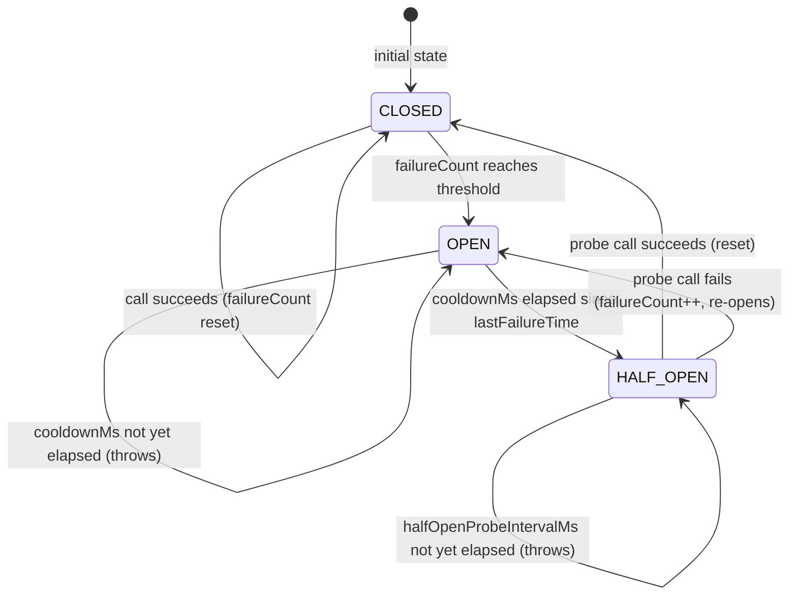
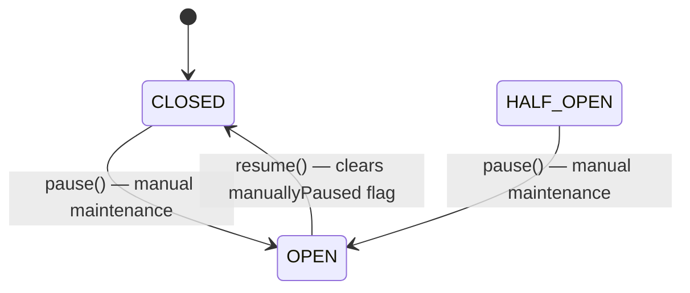

# CircuitBreaker State Transitions

The `CircuitBreaker` class in `src/circuitBreaker.ts` protects RPC calls from
cascading failures by cycling through three states: **CLOSED**, **OPEN**, and
**HALF_OPEN**.

## State-Transition Diagram



### Manual pause/resume overlay



> When the circuit is manually paused (`pause()`), `manuallyPaused = true` and
> all calls throw **before** the normal state-machine checks.  
> `resume()` clears `manuallyPaused` **and** resets the failure counter,
> returning immediately to `CLOSED`.

---

## States

| State       | Description |
|-------------|-------------|
| `CLOSED`    | Normal operation. All calls are forwarded to the wrapped function. Failures are counted but don't block calls until `threshold` is reached. |
| `OPEN`      | Circuit tripped. All calls throw immediately with `"RPC endpoint unavailable (circuit breaker open)"`. No downstream calls are made. |
| `HALF_OPEN` | Recovery probe mode. A single probe call is allowed every `halfOpenProbeIntervalMs`. Subsequent callers during the interval see `"circuit breaker half-open, next probe in Nms"`. |

---

## Transitions

| From       | Trigger                                                         | To         | Relevant parameter          |
|------------|-----------------------------------------------------------------|------------|-----------------------------|
| `CLOSED`   | A call succeeds                                                 | `CLOSED`   | — (failureCount reset to 0) |
| `CLOSED`   | `failureCount` reaches `threshold`                              | `OPEN`     | `threshold` (default: **3**) |
| `OPEN`     | `Date.now() - lastFailureTime >= cooldownMs`                    | `HALF_OPEN`| `cooldownMs` (default: **30 000 ms**) |
| `OPEN`     | Cooldown not yet elapsed                                        | `OPEN`     | `cooldownMs` |
| `HALF_OPEN`| Probe call succeeds                                             | `CLOSED`   | — |
| `HALF_OPEN`| Probe call fails                                                | `OPEN`     | `cooldownMs` (resets timer) |
| `HALF_OPEN`| `halfOpenProbeIntervalMs` not yet elapsed since last probe      | `HALF_OPEN`| `halfOpenProbeIntervalMs` (default: equals `cooldownMs`) |
| Any        | `pause()` called                                                | `OPEN`     | — (sets `manuallyPaused`) |
| `OPEN` (manually paused) | `resume()` called                             | `CLOSED`   | — (clears `manuallyPaused`, resets count) |

---

## Timing parameters

| Parameter               | Default        | Description |
|-------------------------|----------------|-------------|
| `threshold`             | `3`            | Number of consecutive failures before the circuit opens. |
| `cooldownMs`            | `30 000` ms    | Minimum time the circuit stays `OPEN` before a probe is allowed. Also the default for `halfOpenProbeIntervalMs`. |
| `halfOpenProbeIntervalMs` | `cooldownMs` | Minimum time between successive probes while in `HALF_OPEN`. Configure independently to allow faster probing without shortening the initial open-state cooldown. |

---

## Configuring thresholds for typical SDK usage

### High-volume production app
```ts
const breaker = new CircuitBreaker({
  threshold: 5,          // tolerate brief bursts; open only on sustained failures
  cooldownMs: 60_000,    // wait a full minute before probing
  halfOpenProbeIntervalMs: 5_000, // probe every 5 s once in HALF_OPEN
});
```

### Low-latency trading / streaming UI
```ts
const breaker = new CircuitBreaker({
  threshold: 2,          // fail fast — user-visible latency matters
  cooldownMs: 10_000,
  halfOpenProbeIntervalMs: 2_000,
});
```

### Background batch processor
```ts
const breaker = new CircuitBreaker({
  threshold: 10,         // tolerate more transient errors in batch work
  cooldownMs: 120_000,   // long cooldown; batches can wait
  halfOpenProbeIntervalMs: 30_000,
});
```

### Maintenance window (manual pause)
```ts
// Take the circuit out of service during a planned deployment.
breaker.pause();
// ... deploy ...
breaker.resume(); // re-opens for traffic, failure counter reset
```

---

## Relationship to `CircuitBreakerOptions`

```ts
export interface CircuitBreakerOptions {
  /** Number of failures before opening (default 3). */
  threshold?: number;
  /** Cooldown in ms before first probe (default 30 000). */
  cooldownMs?: number;
  /**
   * Time between successive HALF_OPEN probes.
   * Defaults to `cooldownMs` if not supplied.
   * Allows combining a long open-state cooldown with a fast probe rate.
   */
  halfOpenProbeIntervalMs?: number;
}
```
